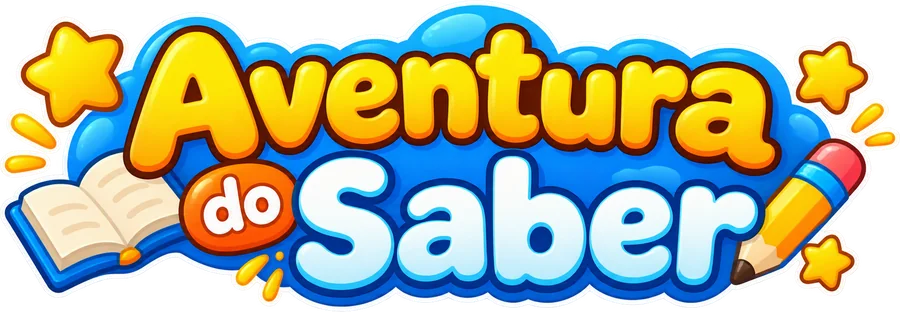
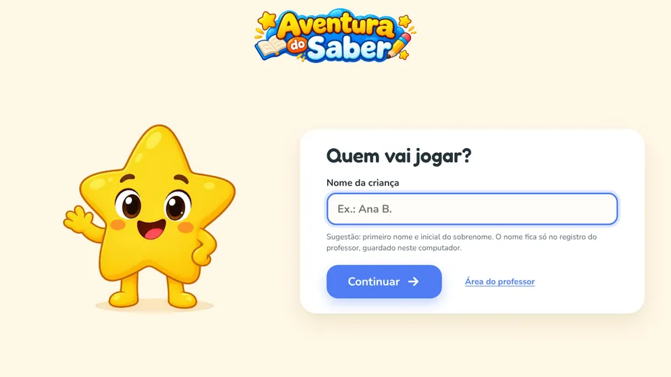
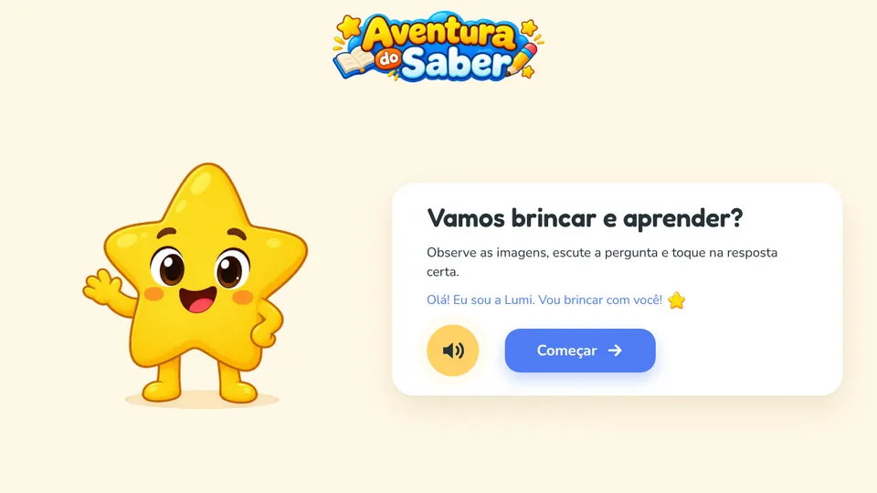
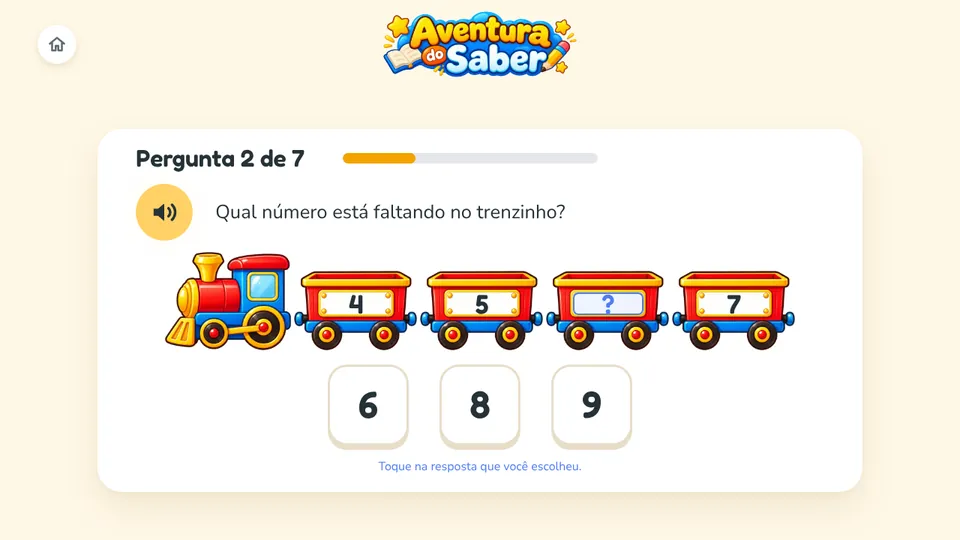
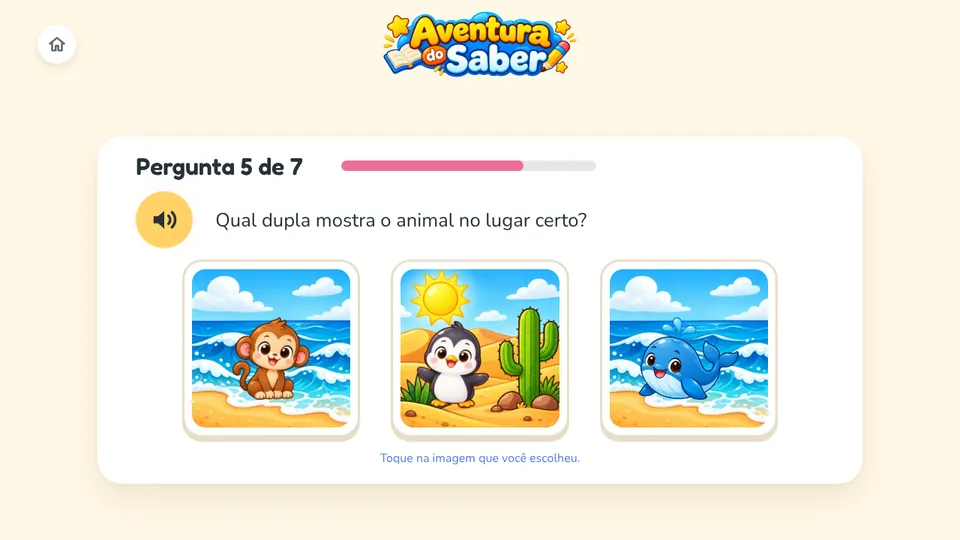
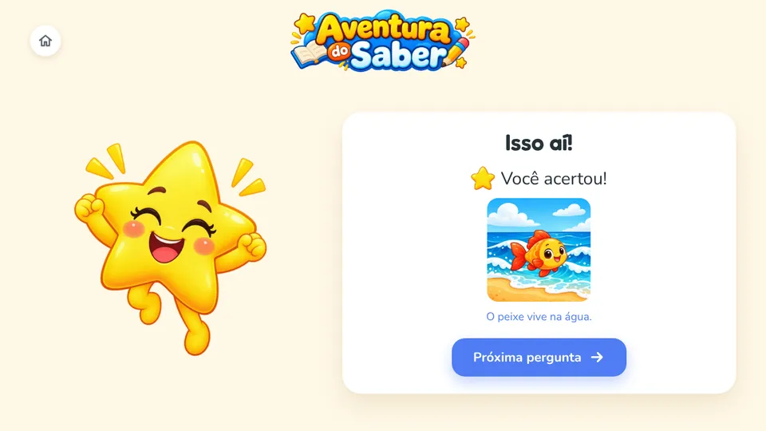
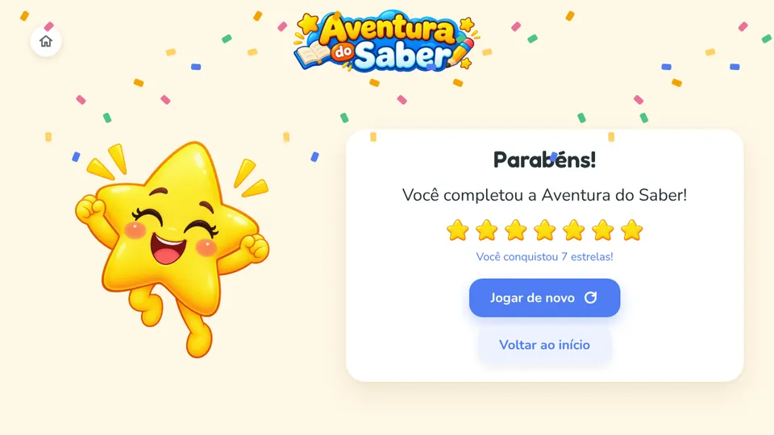

<p align="center">
  
</p>

<p align="center">
  <strong>Jogo educacional para crianças da Educação Infantil · Pré-Escola II (5 e 6 anos)</strong><br>
  Curricularização da Extensão 2026/2 · Sistemas de Informação · UNIFEBE<br>
  Em parceria com a Secretaria Municipal de Educação de Brusque (SC)
</p>

<p align="center">
  <a href="https://da-trindade.github.io/aventura-do-saber/"><strong>▶ Jogar agora</strong></a>
</p>

---

## Apresentação

O Aventura do Saber é um jogo educacional desenvolvido na Curricularização da Extensão 2026/2 do curso de Sistemas de Informação da UNIFEBE, em parceria com a Secretaria Municipal de Educação de Brusque. O jogo foi pensado para crianças da Pré-Escola II, com idade entre 5 e 6 anos, e para funcionar direto no navegador, inclusive nos Chromebooks das escolas municipais, sem nenhuma instalação.

O projeto começou na primeira etapa, quando elaborei o banco de perguntas e o protótipo no Figma. O protótipo foi selecionado e encaminhado à Secretaria. Nesta etapa, transformei esse protótipo em uma aplicação web funcional, publicada pelo GitHub Pages.

> **Critério central do projeto:** a criança deve conseguir compreender cada atividade com apoio de imagens e áudio, sem depender da leitura.

## Objetivos

- entregar uma versão funcional e navegável do jogo, com início, meio e fim;
- trabalhar quatro áreas de conhecimento por meio de 21 desafios curtos;
- oferecer uma interface adequada ao público infantil, com voz, imagens e botões grandes;
- registrar as tentativas de cada criança para apoiar o acompanhamento do professor;
- validar a experiência de uso em diferentes navegadores e tamanhos de tela.

## Como o jogo funciona

**Início.** O professor, ou outro adulto, digita o nome da criança. Em seguida, a Lumi, a estrelinha que guia o jogo, se apresenta e convida a criança a brincar.

**Meio.** São três níveis jogados em sequência (Fácil, Médio e Difícil), com 7 desafios cada. A Lumi lê cada pergunta em voz alta, e a criança responde tocando ou clicando na imagem ou no número que escolheu. Em um dos desafios, ela arrasta a bola até o lugar certo. Quando acerta, ganha uma estrela e ouve uma frase que explica a resposta. Quando erra, a Lumi incentiva uma nova tentativa, sem mensagens de erro e sem pontuação negativa.

**Fim.** Ao concluir cada nível, a criança vê as estrelas que conquistou. Depois do Nível Difícil, o jogo comemora a conclusão da aventura e oferece a opção de jogar de novo.

<table>
  <tr>
    <td align="center" width="50%"><br><sub>Início: identificação da criança</sub></td>
    <td align="center" width="50%"><br><sub>Início: a Lumi apresenta o jogo</sub></td>
  </tr>
  <tr>
    <td align="center"><br><sub>Meio: desafio de contagem</sub></td>
    <td align="center"><br><sub>Meio: desafio sobre animais e seus habitats</sub></td>
  </tr>
  <tr>
    <td align="center"><br><sub>Meio: retorno positivo depois do acerto</sub></td>
    <td align="center"><br><sub>Fim: conclusão da aventura</sub></td>
  </tr>
</table>

## Áreas de conhecimento

Optei por concentrar as 21 perguntas em quatro áreas. Essa escolha permite trabalhar raciocínio matemático, percepção espacial, conhecimento sobre a natureza e linguagem oral, sem tornar o jogo longo ou cansativo para crianças pequenas.

| Área | O que a criança faz | Referência na BNCC | Perguntas |
|---|---|---|:---:|
| Contagem e quantidades | conta de 3 a 9 elementos e completa sequências numéricas | EI03ET07 | 6 |
| Noções espaciais | reconhece as posições dentro, em cima, embaixo, entre e atrás | EI02ET04 (consolidação) | 5 |
| Animais e seus habitats | associa animais aos ambientes em que vivem | EI03ET03 (aproximação) | 5 |
| Consciência silábica | conta e compara os "pedacinhos" (sílabas) das palavras | Campo "Escuta, fala, pensamento e imaginação" | 5 |
| **Total** | | | **21** |

A dificuldade aumenta de forma gradual entre os níveis: mais elementos para contar, alternativas mais parecidas e a necessidade de comparar mais de uma informação. O nível difícil não traz conteúdos de etapas posteriores; ele apenas exige mais atenção.

## Uma interface pensada para crianças

- todas as perguntas são faladas pela Lumi, e o botão de som repete a fala sempre que a criança quiser;
- as respostas são imagens ou números grandes, fáceis de tocar na tela;
- cada tela mostra poucos elementos, para a atenção ficar na atividade;
- o erro nunca aparece em vermelho: a alternativa escolhida fica apagada e a criança tenta outra vez;
- todo desafio concluído vale uma estrela dourada, valorizando o esforço e não só o acerto de primeira;
- o jogo funciona com toque, mouse ou teclado e se ajusta a telas de diferentes tamanhos.

## Acompanhamento pelo professor

Na primeira tela, o botão **Área do professor** permite baixar um arquivo de texto com todas as tentativas. Cada toque da criança vira uma linha com nome, data, hora, nível, pergunta, área, assunto, habilidade (com a referência da BNCC), tentativa, resposta escolhida e resultado. No final do arquivo há um resumo por criança e por dia, com os acertos na primeira tentativa em cada área.

Esses registros servem para acompanhar a atividade, e não para avaliar a criança: um erro pode significar apenas um toque acidental.

## Privacidade

O jogo não tem cadastro, login, anúncios nem envio de dados pela internet. O único dado pessoal é o nome digitado pelo adulto, que fica guardado apenas no navegador do computador usado. Recomendo usar o primeiro nome e a inicial do sobrenome e apagar os registros depois de baixar o arquivo, principalmente em computadores compartilhados. Em janela anônima ou no modo visitante do Chromebook, os registros são apagados quando a sessão termina.

## Como jogar

- **Online:** abra https://da-trindade.github.io/aventura-do-saber/ no Google Chrome, no Microsoft Edge ou no Mozilla Firefox.
- **Sem internet:** nesta página, clique em **Code > Download ZIP**, extraia o arquivo e abra o `index.html` no navegador.
- Como as perguntas são faladas, recomendo volume moderado ou fones de ouvido.

## Tecnologias e organização do projeto

Optei por desenvolver o jogo apenas com HTML, CSS e JavaScript, sem frameworks e sem bibliotecas externas. Assim, ele funciona direto no navegador, carrega rápido mesmo em conexões limitadas e é simples de manter. As imagens estão em WebP, as falas em MP3 e as fontes ficam dentro do próprio projeto.

```
aventura-do-saber/
├── index.html          página do jogo, com todas as telas
├── css/estilo.css      aparência: cores, fontes, botões e adaptação às telas
├── js/perguntas.js     banco de perguntas (conteúdo pedagógico)
├── js/jogo.js          fluxo do jogo: telas, respostas, tentativas e estrelas
├── js/cenas.js         montagem das imagens de cada pergunta e do arrastar
├── js/audio.js         reprodução das falas e do som de acerto
├── js/registro.js      registro das tentativas e arquivo de texto
├── img/                ilustrações
├── audio/              falas da Lumi
├── fonts/              fontes Fredoka e Nunito e suas licenças
├── capturas/           imagens usadas neste README
├── testes/             testes automatizados
└── .nojekyll           faz o GitHub Pages publicar os arquivos como estão
```

O conteúdo fica separado da lógica do jogo. Para revisar uma pergunta, basta editar `js/perguntas.js`; para trocar uma imagem, basta substituir o arquivo na pasta `img/` mantendo o mesmo nome.

## Validação

Para validar a versão final, conferi os pontos que serão observados na avaliação do projeto:

| O que foi verificado | Como |
|---|---|
| O jogo abre e funciona do início ao fim | partida completa nos três níveis, na versão publicada |
| Navegação entre as perguntas | testes automatizados e partidas manuais |
| Interações por toque, mouse e teclado, incluindo o arrastar | testes automatizados |
| Respostas corretas configuradas | as 21 respostas conferidas com o banco de perguntas e testadas no jogo |
| Recursos visuais e sonoros | todas as imagens exibidas e todas as 63 falas tocadas numa partida completa |
| Adaptação às telas | testes em cinco tamanhos, do celular ao notebook |
| Navegadores | Google Chrome, Microsoft Edge e Mozilla Firefox |

Os testes automatizados ficam em `testes/teste_jogo.py` e usam o Playwright com o navegador Chromium. Para executá-los, com o Python instalado:

```
pip install playwright
python -m playwright install chromium
python testes/teste_jogo.py
```

## Uso de inteligência artificial

Usei ferramentas de inteligência artificial como apoio no desenvolvimento:

- **ilustrações:** geradas com o ChatGPT (OpenAI) a partir das minhas descrições e tratadas para o jogo (recorte, fundo transparente e pequenos ajustes);
- **voz da Lumi:** voz sintética pt-BR-FranciscaNeural, do Azure AI Speech (Microsoft), com velocidade reduzida em 10%;
- **programação:** o código foi desenvolvido com apoio do assistente Claude (Anthropic).

O conteúdo pedagógico, o banco de perguntas, o protótipo e as escolhas de interface são de minha autoria.

## Créditos

- Protótipo no Figma: [Aventura do Saber: Protótipo Inicial](https://www.figma.com/proto/K2aMxba772v2MyNPQmZ2yj/Aventura-do-Saber-%E2%80%94-Prot%C3%B3tipo-Inicial?node-id=8-2&starting-point-node-id=8%3A2)
- Fontes [Fredoka](https://fonts.google.com/specimen/Fredoka) e [Nunito](https://fonts.google.com/specimen/Nunito), sob a SIL Open Font License 1.1 (licenças na pasta `fonts/`)
- Som de acerto gerado pelo próprio navegador (Web Audio API)

## Integrante

**Daniel da Trindade**, acadêmico de Sistemas de Informação da UNIFEBE

---

<p align="center"><sub>Centro Universitário de Brusque (UNIFEBE) · Curso de Sistemas de Informação · Curricularização da Extensão 2026/2 · Brusque (SC), 2026</sub></p>
